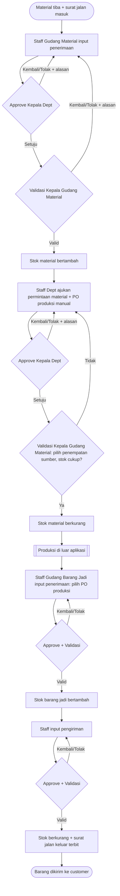

# PRD — Aplikasi Warehouse Management (WMS) Batching Plant Beton

| | |
|---|---|
| **Versi** | 1.0 (draft untuk review) |
| **Tanggal** | 9 November 2026 |
| **Sumber** | `docs/Requirement Aplikasi Warehouse Management – Batching Plant Beton.pdf` (27 hlm) |
| **Dokumen pasangan** | `docs/Technical Logic - WMS Batching Plant Beton.md` |
| **Status** | Menunggu jawaban Open Questions (bagian 13) |

**Konvensi:** ID `FR-xx`, `NFR-xx`, `UC-xx` mengikuti dokumen sumber. Hal yang **tidak ada di sumber** dan saya tambahkan ditandai **[Usulan]** supaya mudah ditolak atau disetujui satu per satu. Aturan bisnis baru memakai ID `BR-11` ke atas; `BR-01` sampai `BR-10` berasal dari sumber.

---

## 1. Ringkasan

Pabrik batching plant beton membutuhkan **satu sumber data stok** untuk dua jenis gudang: **gudang material** (bahan baku) dan **gudang barang jadi**. Aplikasi web ini mencatat setiap pergerakan stok (masuk, keluar, pindah, opname) **per penempatan** di dalam gudang. Setiap pergerakan memakai dokumen yang sudah dipakai pabrik (surat jalan masuk, PO produksi, surat jalan keluar) dan melewati **approval Kepala Departemen, lalu validasi Kepala Gudang**.

Proses produksi (resep, batching, mixing) **tidak** masuk aplikasi. Aplikasi hanya mencatat material yang keluar ke produksi dan barang jadi yang kembali masuk. Keduanya dihubungkan lewat **PO produksi** yang diinput manual saat permintaan material.

Nilai utama:
1. Stok akurat per item per lokasi, tidak pernah negatif.
2. Setiap perubahan stok bisa ditelusuri ke dokumen dan orang yang bertanggung jawab.
3. Dashboard dan laporan sesuai peran masing-masing user.

## 2. Masalah, Tujuan, dan Non-Tujuan

### Masalah yang diselesaikan
- Tidak ada satu sumber kebenaran untuk jumlah stok, lokasi, pelaku, dan dokumen dasarnya.
- Pemakaian material dan pengiriman barang jadi belum punya jejak approval yang terdokumentasi.
- Gudang dan struktur rak belum final, sehingga solusi yang mengunci struktur akan cepat usang.

### Tujuan
| # | Tujuan | Cara diukur **[Usulan]** |
|---|---|---|
| G1 | Stok per penempatan akurat dan tidak negatif | Selisih opname fase 2 menurun antar-periode; rekonsiliasi harian ledger vs saldo = 0 selisih |
| G2 | Seluruh perubahan stok punya dokumen dan pelaku | 100% baris ledger punya `doc_type`, `doc_id`, `posted_by` |
| G3 | Approval terdokumentasi dan tidak bisa dilewati | 0 dokumen mengubah stok tanpa langkah validasi Kepala Gudang |
| G4 | Gudang dan penempatan baru bisa ditambah tanpa coding | Admin menambah gudang + 3 level lokasi tanpa developer |
| G5 | Input transaksi cepat di tablet gudang | Input penerimaan selesai < 2 menit untuk 5 baris item; respons halaman < 2 detik (NFR-01) |

### Non-tujuan (fase 1)
Proses produksi, resep/mixing, modul pembuatan PO produksi mandiri, pembelian/keuangan/akuntansi, barcode/QR scanner, konversi satuan antar-unit, multi-gudang dalam satu dokumen (transfer antar gudang).

## 3. Pengguna dan Peran

| Kode | Peran | Tugas utama | Kepentingan |
|---|---|---|---|
| A1 | Staff Gudang Material | Input penerimaan material, pindah penempatan, hitung opname | Pencatatan cepat, lokasi stok jelas |
| A2 | Staff Gudang Barang Jadi | Input penerimaan barang jadi, pengiriman, pindah penempatan, hitung opname | Stok barang jadi dan surat jalan akurat |
| A3 | Staff Departemen (mis. produksi) | Mengajukan permintaan material | Material tersedia, status approval terlihat |
| A4 | Kepala Departemen | Menyetujui dokumen departemennya | Kontrol pemakaian material |
| A5 | Kepala Gudang (per gudang) | Validasi dokumen gudangnya, pilih penempatan sumber, menyetujui opname | Stok fisik = sistem |
| A6 | Admin Sistem | Master data, user, role, konfigurasi approval, dashboard | Aplikasi mudah dirawat |
| A7 | Manajemen | Melihat dashboard dan laporan (baca saja) | Gambaran stok dan pergerakan |

**Auth:** berdiri sendiri, memakai **Supabase Auth** (JWT) dengan RBAC per role dan per gudang. SSO hanya titik sambung untuk fase berikutnya. **Stack:** Next.js + Supabase (Postgres, Auth, Storage, Realtime), sesuai rekomendasi dokumen sumber; rincian di Technical Logic.

## 4. Scope

### In-scope fase 1
Master data (gudang, penempatan, item, satuan, pihak luar, user/role/departemen) · penerimaan material · permintaan material · pemindahan penempatan · penerimaan barang jadi · pengiriman + surat jalan keluar PDF · pelacakan PO produksi · engine approval/validasi · kartu stok · dashboard per user · laporan + export · audit trail · notifikasi in-app.

### In-scope fase 2
Stock opname kedua gudang (data model disiapkan sejak fase 1).

### Out-of-scope
Proses produksi · PO produksi sebagai modul sendiri · pembelian, keuangan, akuntansi (ERP nanti) · barcode/QR (kode unik disiapkan agar bisa dilabeli kelak) · transfer antar gudang.

## 5. Prioritas Modul dan Jalur Kritis

| Modul | Prioritas | Alasan | Bila perlu dipangkas |
|---|---|---|---|
| M0 Master data + Auth + RBAC | **P0** | Fondasi semua modul | Tidak bisa dipangkas |
| M1 Gudang Material (penerimaan, permintaan, pindah) | **P0** | Alur inti material | Tidak bisa dipangkas |
| Engine approval/validasi + posting stok | **P0** | Stok hanya berubah lewat sini | UI konfigurasi alur (UC-06) boleh P1; alur default cukup di-seed |
| M2 Gudang Barang Jadi (penerimaan, pengiriman, surat jalan) | **P0** | Alur inti barang jadi | Tidak bisa dipangkas |
| Kartu stok + laporan stok/mutasi | **P0** | Bukti akurasi (G1, G2) | Laporan lain boleh P1 |
| Audit trail | **P0** | FR-22 High; syarat auditabilitas | Layar penelusuran boleh sederhana |
| Dashboard per user | **P1** | FR-20 High di sumber, tetapi dashboard bawaan per role bisa menutupi go-live | Widget yang bisa dipilih user = P1; dashboard tetap per role = P0 **[Usulan]** |
| Notifikasi in-app + inbox approval | **P1** | Mempercepat approval, bukan syarat stok benar | Inbox approval (UC-21) tetap diperlukan agar approver menemukan dokumen |
| Transaksi pembalik (UC-24) | **P1** | Satu-satunya jalur koreksi dokumen tervalidasi | Tidak boleh ditunda lama; tanpanya koreksi harus lewat database |
| Stock opname | **P2** (fase 2) | Sudah ditetapkan fase 2 | — |
| Integrasi ERP, SSO, WA/email, BI, QR | **P2** | Bukan syarat go-live | — |

**Jalur kritis:** Master data → Auth/RBAC → Engine posting stok (atomik) → Penerimaan material → Permintaan material (approval + alokasi penempatan) → Penerimaan barang jadi (butuh PO produksi dari permintaan material) → Pengiriman + surat jalan. Penerimaan barang jadi **tergantung** pada permintaan material karena PO produksi hanya lahir dari sana (BR-03).

## 6. Alur Bisnis Ringkas

Pemindahan antar penempatan berjalan di samping alur ini. Stock opname (fase 2) menyesuaikan stok lewat approval yang sama.

## 7. Kebutuhan Fungsional per Modul

Format: **user story**, lalu **kriteria penerimaan (AC)** yang bisa langsung dijadikan test case.

### 7.1 Master Data (M0) — P0

**FR-01 Gudang** — *Sebagai Admin, saya menambah gudang baru dengan kategori Material atau Barang Jadi tanpa developer.*
- AC: kode gudang unik; kategori wajib dan **tidak bisa diubah** bila gudang sudah punya transaksi **[Usulan]**; Kepala Gudang ditetapkan per gudang; gudang dinonaktifkan, tidak dihapus.

**FR-02 Penempatan** — *Sebagai Admin atau Kepala Gudang, saya membuat pohon lokasi bebas (nama + tipe, mis. zona → aisle → rak).*
- AC: kedalaman pohon tidak dibatasi; tipe adalah teks bebas; penempatan bisa ditambah, diubah, dinonaktifkan; **penempatan berisi stok tidak bisa dinonaktifkan** sebelum stoknya dipindah (BR-09); penempatan nonaktif tidak muncul sebagai pilihan transaksi baru; kode unik per penempatan agar kelak bisa dilabeli QR.
- Catatan: stok disimpan di **leaf maupun node** mana pun. Lihat keputusan di Technical Logic bagian 3.4.

**FR-03 Item** — *Sebagai Admin, saya mengelola item material dan barang jadi beserta kategorinya.*
- AC: setiap item wajib punya satuan; **jenis satuan harus sama dengan jenis item** (item material hanya satuan material; item barang jadi hanya satuan barang jadi); kode item unik; item tidak dihapus, hanya dinonaktifkan; satuan item **tidak bisa diganti** setelah ada pergerakan stok **[Usulan]**.

**FR-24 Satuan** — *Sebagai Admin, saya mengelola satuan material (kg, sak, liter) dan satuan barang jadi secara terpisah.*
- AC: dua jenis satuan; tambah, ubah, nonaktifkan; satuan yang dipakai item aktif tidak bisa dinonaktifkan **[Usulan]**; daftar awal menunggu konfirmasi pabrik.

**FR-04 User, role, departemen** — *Sebagai Admin, saya mengelola user, role, departemen, dan penugasan kepala.*
- AC: Kepala Gudang ditetapkan **per gudang**, Kepala Departemen **per departemen**; staff gudang diberi akses ke gudang tertentu **[Usulan]**; user dinonaktifkan, tidak dihapus (menjaga jejak audit).

**FR-05 Pihak luar** — *Sebagai Admin, saya mengelola customer (tujuan surat jalan keluar) dan pengirim material.*
- AC: satu master pihak dengan jenis CUSTOMER dan/atau SUPPLIER **[Usulan]** karena Open Question #1 belum menentukan apakah pengirim material adalah supplier atau customer.

### 7.2 Gudang Material (M1) — P0

**FR-06, FR-07, FR-08 Penerimaan material (UC-07)** — *Sebagai Staff Gudang Material, saya mencatat material yang tiba berdasarkan surat jalan masuk.*
- Input: nomor surat jalan masuk, tanggal, pengirim, referensi PO (nomor, pihak, tanggal), daftar item + qty + penempatan tujuan per baris; lampiran foto surat jalan **[Usulan]** (sumber menyebut storage untuk foto).
- AC: nomor surat jalan masuk **tidak boleh dobel untuk pengirim yang sama** (BR-08); hanya item bertipe material dan penempatan di gudang material yang dipilih; qty > 0; stok **baru bertambah saat Kepala Gudang memvalidasi**, bukan saat submit; dokumen yang ditolak membebaskan nomor surat jalan untuk dibuat ulang **[Usulan]**.

**FR-09 Permintaan material (UC-08)** — *Sebagai Staff Departemen, saya meminta material untuk produksi dengan PO produksi yang saya input manual.*
- Input: nomor PO produksi, produk target (barang jadi), qty target, daftar material + qty, gudang material yang melayani.
- AC: nomor PO produksi unik (BR-03); bila nomor sudah ada, user memilih PO tersebut dan tidak membuat duplikat **[Usulan]** (lihat Technical Logic bagian 8); saat submit sistem **memperingatkan** bila stok total tidak cukup, tetapi tidak memblokir (BR-02).

**FR-10, FR-11, UC-11 Approval dan alokasi sumber** — *Sebagai Kepala Departemen, saya menyetujui permintaan; sebagai Kepala Gudang Material, saya menentukan dari penempatan mana tiap material diambil lalu memvalidasi.*
- AC: urutan Kepala Departemen lalu Kepala Gudang; penempatan sumber ditentukan **saat validasi**; satu baris permintaan boleh dipecah ke beberapa penempatan **[Usulan]**; total alokasi sama dengan qty diminta; bila stok di penempatan kurang, **validasi diblokir** dan dokumen tetap menunggu validasi atau dikembalikan.

**FR-12 Tolak/kembalikan** — AC: tolak dan kembalikan **wajib alasan** (BR-10); dokumen dikembalikan menjadi Draft untuk direvisi pembuat; ditolak bersifat final.

**FR-15, UC-12 Pemindahan penempatan** — *Sebagai Staff Gudang, saya memindahkan stok dari satu penempatan ke penempatan lain dalam gudang yang sama.*
- AC: asal dan tujuan di gudang yang sama dan tidak boleh identik; **total stok gudang tetap**; default tanpa approval, tetap divalidasi Kepala Gudang terkait; asal harus cukup saat validasi.

### 7.3 Gudang Barang Jadi (M2) — P0

**FR-13, FR-14, UC-13 Penerimaan barang jadi** — *Sebagai Staff Gudang Barang Jadi, saya mencatat barang jadi yang kembali dari produksi dengan memilih PO produksi.*
- AC: PO produksi **wajib dipilih dari yang sudah ada**; tidak ada tombol membuat PO baru; penerimaan **bertahap** (satu PO bisa diterima berkali-kali); sistem menampilkan **target, sudah diterima, sisa**; bila total melebihi target, **peringatan** (tidak memblokir); item harus sama dengan produk target PO (asumsi satu PO satu jenis barang jadi, lihat Open Questions).

**FR-16, FR-17, UC-14, UC-15 Pengiriman keluar dan surat jalan** — *Sebagai Staff Gudang Barang Jadi, saya menyiapkan pengiriman dan mencetak surat jalan keluar.*
- Input: customer tujuan, tanggal, item, qty, penempatan sumber.
- AC: stok berkurang dan **surat jalan keluar terbit hanya setelah validasi**; nomor surat jalan **otomatis, unik, berurutan tanpa celah** (BR-08, NFR-09); PDF bisa dicetak ulang kapan saja dari data tervalidasi; stok tidak cukup saat validasi memblokir.

### 7.4 Approval dan Validasi — P0

**Matriks jalur default (dikonfigurasi per jenis transaksi, FR-10/FR-17/UC-06):**

| Transaksi | Pembuat | Approval | Validasi | Efek stok |
|---|---|---|---|---|
| Penerimaan material | Staff Gudang Material | Kepala Dept pembuat | Kepala Gudang Material | + di penempatan tujuan |
| Permintaan material | Staff Dept peminta | Kepala Dept peminta | Kepala Gudang Material | − dari penempatan sumber |
| Pemindahan penempatan | Staff gudang | Tanpa approval | Kepala Gudang terkait | Total tetap, lokasi berubah |
| Penerimaan barang jadi | Staff Gudang Barang Jadi | Kepala Dept pembuat | Kepala Gudang Barang Jadi | + di penempatan tujuan |
| Pengiriman keluar | Staff Gudang Barang Jadi | Kepala Dept pembuat | Kepala Gudang Barang Jadi | − ; surat jalan terbit |
| Stock opname (fase 2) | Staff gudang | Kepala Dept pembuat | Kepala Gudang terkait | Disesuaikan sebesar selisih |

**Status dokumen:** `Draft → Menunggu Approval → Menunggu Validasi → Tervalidasi`; cabang `Dikembalikan` (kembali ke Draft setelah revisi) dan `Ditolak` (final).

**Aturan pelengkap**
- **BR-05 Pemisahan tugas:** pembuat tidak boleh menyetujui atau memvalidasi dokumennya sendiri.
- **BR-06 Validasi per gudang:** Kepala Gudang hanya memvalidasi dokumen gudang yang ditugaskan kepadanya.
- **BR-07 Terkunci:** dokumen tervalidasi tidak bisa diedit; koreksi lewat **transaksi pembalik** yang juga melewati approval (UC-24).
- **UC-21 Inbox approval:** approver melihat dokumen yang menunggu keputusannya.
- **FR-23 Notifikasi in-app** untuk dokumen yang menunggu approval/validasi dan untuk hasil keputusan ke pembuat.
- **UC-06 Konfigurasi alur:** Admin menyalakan atau mematikan langkah **Kepala Departemen** per jenis transaksi. Langkah **validasi Kepala Gudang tidak dapat dimatikan [Usulan]**, karena stok hanya boleh berubah lewat validasi (aturan stok di bawah).

### 7.5 Monitoring dan Pelaporan — P0 / P1

**FR-18, UC-16 Stok dan kartu stok (P0)** — AC: stok dapat dilihat per gudang, per penempatan, per item; kartu stok per item per penempatan per periode menampilkan saldo awal, masuk, keluar, saldo akhir, dan dokumen asal yang bisa diklik; saldo kartu stok **selalu sama** dengan saldo stok saat ini.

**FR-14, UC-17 Pelacakan PO produksi (P1)** — AC: per PO ditampilkan material diambil (dari permintaan tervalidasi), barang jadi diterima, dan sisa terhadap target.

**FR-20, UC-19 Dashboard per user (P1; versi per role P0)** — AC: user atau Admin memilih widget dan filter; widget dibatasi oleh hak akses data user; setiap role punya dashboard default.

**FR-21, UC-20 Laporan (P0 stok & mutasi; sisanya P1)** — AC: laporan stok, mutasi, penerimaan, permintaan, pengiriman, opname; akses per role; **export Excel dan PDF**.

**FR-22, UC-23 Audit trail (P0)** — AC: siapa mengubah apa dan kapan, termasuk **perubahan master data dan keputusan approval**; hanya Admin dan Manajemen yang melihat; jejak tidak bisa diubah atau dihapus dari aplikasi.

### 7.6 Stock Opname — P2 (fase 2)

**FR-19, UC-18** — AC: sesi opname per gudang; hitung fisik per penempatan; sistem menghitung selisih terhadap stok sistem; selisih lewat approval lalu validasi Kepala Gudang; penyesuaian stok dicatat sebagai pergerakan ledger berdokumen opname (bukan edit saldo). Pertanyaan penguncian transaksi selama opname masih terbuka.

## 8. Aturan Bisnis

| ID | Aturan | Sumber |
|---|---|---|
| BR-01 | Stok dicatat per item per penempatan; stok total gudang = penjumlahan | Sumber |
| BR-02 | Stok tidak boleh negatif. Peringatan saat submit, **blokir** saat validasi bila stok penempatan tidak cukup | Sumber |
| BR-03 | PO produksi hanya lahir dari permintaan material; nomor input manual dan unik; penerimaan barang jadi hanya memilih PO yang sudah ada | Sumber |
| BR-04 | Penerimaan barang jadi bertahap; tampilkan sisa; peringatan bila total melebihi target | Sumber |
| BR-05 | Pembuat tidak boleh menyetujui atau memvalidasi dokumennya sendiri | Sumber |
| BR-06 | Kepala Gudang hanya memvalidasi dokumen untuk gudang yang ditugaskan | Sumber |
| BR-07 | Dokumen tervalidasi terkunci; koreksi lewat transaksi pembalik yang diapprove | Sumber |
| BR-08 | Nomor surat jalan masuk tidak dobel per pengirim; nomor surat jalan keluar otomatis, unik, berurutan | Sumber |
| BR-09 | Penempatan berisi stok tidak bisa dinonaktifkan sebelum stoknya dipindah | Sumber |
| BR-10 | Penolakan dan pengembalian wajib alasan | Sumber |
| BR-11 | **Stok hanya berubah saat validasi Kepala Gudang**; Draft, Menunggu Approval, Menunggu Validasi tidak mengubah stok | Sumber (aturan stok) |
| BR-12 | Langkah validasi Kepala Gudang tidak bisa dimatikan lewat konfigurasi approval | **[Usulan]** |
| BR-13 | Konfigurasi approval berlaku untuk dokumen **baru**; dokumen yang sedang berjalan memakai alur saat ia disubmit | **[Usulan]** |
| BR-14 | Ledger append-only; saldo hanya diubah oleh layanan stok | Sumber (NFR-02) |
| BR-15 | Item hanya boleh dipakai pada gudang dengan kategori yang sama dengan jenis item (material ↔ gudang Material, barang jadi ↔ gudang Barang Jadi) | **[Usulan]** |
| BR-16 | Master tidak dihapus bila sudah dipakai; hanya dinonaktifkan | **[Usulan]** |

## 9. Kebutuhan Non-Fungsional

Angka bersumber dari usulan awal dokumen requirement dan perlu disepakati dengan pabrik.

| ID | Kategori | Target | Catatan implementasi |
|---|---|---|---|
| NFR-01 | Performance | Halaman utama dan input transaksi < 2 detik pada kondisi normal | Index pada `stock_balance(item_id, location_id)` dan ledger per item/lokasi/waktu |
| NFR-02 | Integritas data | Transaksi stok atomik; stok tidak pernah negatif; ledger tidak bisa diubah, koreksi lewat transaksi baru | `CHECK (qty >= 0)`, trigger tolak UPDATE/DELETE ledger |
| NFR-03 | Security | RBAC per role dan per gudang; OWASP Top 10; password ter-hash | RLS per gudang; hash argon2/bcrypt |
| NFR-04 | Auditability | Semua perubahan stok dan approval punya jejak user dan waktu | Ledger + audit log + approval step |
| NFR-05 | Availability | Dapat diakses selama jam operasional; target 99,5% | Satu server aplikasi + satu DB cukup untuk fase 1 |
| NFR-06 | Backup | Backup database harian, uji restore berkala | Jadwalkan uji restore, jangan hanya backup |
| NFR-07 | Usability | Layar input terbaca di tablet; input penerimaan selesai dalam beberapa langkah | Target sentuh ≥ 44 px; form baris item bisa ditambah cepat |
| NFR-08 | Skalabilitas | Tambah gudang dan penempatan tanpa ubah kode atau migrasi struktur | Pohon lokasi via `parent_id` |
| NFR-09 | Keluaran dokumen | Surat jalan keluar bisa dicetak PDF dengan nomor unik berurutan | Penomoran tanpa celah |

## 10. Katalog Laporan dan Dashboard **[Usulan awal]**

Open Question #9 menanyakan daftar yang diinginkan; ini usulan untuk dikoreksi pabrik.

| Laporan | A1 | A2 | A3 | A4 | A5 | A6 | A7 |
|---|---|---|---|---|---|---|---|
| Stok per gudang/penempatan/item | ✔ gudangnya | ✔ gudangnya | – | ✔ baca | ✔ gudangnya | ✔ | ✔ |
| Kartu stok | ✔ | ✔ | – | – | ✔ | ✔ | ✔ |
| Mutasi stok (periode) | ✔ | ✔ | – | – | ✔ | ✔ | ✔ |
| Penerimaan material | ✔ | – | – | ✔ dept | ✔ | ✔ | ✔ |
| Permintaan material | – | – | ✔ miliknya | ✔ dept | ✔ | ✔ | ✔ |
| Penerimaan barang jadi | – | ✔ | – | ✔ dept | ✔ | ✔ | ✔ |
| Pengiriman dan surat jalan | – | ✔ | – | ✔ dept | ✔ | ✔ | ✔ |
| Status PO produksi | – | ✔ | ✔ | ✔ | ✔ | ✔ | ✔ |
| Opname (fase 2) | ✔ | ✔ | – | – | ✔ | ✔ | ✔ |
| Audit trail | – | – | – | – | – | ✔ | ✔ |

**Widget dashboard awal:** total stok per gudang, stok di bawah batas minimum (butuh field `min_stock` pada item **[Usulan]**), dokumen menunggu keputusan saya, dokumen saya yang ditolak/dikembalikan, mutasi 7 hari terakhir, progres PO produksi, penerimaan dan pengiriman hari ini.

## 11. Integrasi

| Kategori | Fase 1 | Fase berikutnya |
|---|---|---|
| Auth | Supabase Auth (JWT) + RBAC per role dan gudang; MFA TOTP opsional untuk Kepala Gudang dan Admin | SSO (Google, Azure AD, Keycloak) bila pabrik punya IdP |
| ERP | Tidak ada. Sediakan REST API baca master item dan mutasi stok | Odoo / Accurate / SAP, menunggu jawaban Open Question #10 |
| Notifikasi | In-app | Email / WhatsApp pengingat approval |
| Storage | PDF surat jalan dan foto surat jalan masuk | — |
| Monitoring | Sentry untuk error; log aplikasi | Grafana/ELK bila perlu |
| BI | Dashboard bawaan | Metabase / Power BI |
| Perangkat lapangan | Tidak diminta; kode unik item dan penempatan disiapkan | Label dan scanner QR |
| Payment gateway | Tidak relevan | — |

## 12. Asumsi dan Risiko

### Asumsi kerja
1. Aplikasi web responsif, diakses dari komputer atau tablet; tidak ada aplikasi native.
2. Satu satuan dasar per item, tanpa konversi (default sampai ada jawaban Open Question #3).
3. Satu PO produksi menghasilkan satu jenis barang jadi dan satu permintaan material dilayani satu gudang material (default sampai ada jawaban Open Question #5).
4. Zona waktu Asia/Jakarta; waktu disimpan dalam UTC.
5. Surat jalan keluar selalu bertujuan ke customer (Open Question #6).
6. Tooling yang sudah ada mengikuti dokumen sumber: Sentry untuk error tracking, GitHub Actions untuk CI/CD, boilerplate Next.js + Supabase.

### Risiko
| # | Risiko | Dampak | Mitigasi |
|---|---|---|---|
| R1 | Kepala Departemen/Gudang berhalangan, dokumen macet | Operasional gudang berhenti | **[Usulan]** pejabat pengganti (deputi) per departemen/gudang; lihat Open Questions |
| R2 | Peringatan stok saat submit tidak menahan stok (tidak ada reservasi); dua permintaan bisa lolos bersamaan lalu salah satu terblokir saat validasi | Pengguna bingung, produksi menunggu | Tampilkan stok tersedia terkini di inbox validasi; pertimbangkan reservasi di fase 2 |
| R3 | Struktur dokumen (surat jalan, penomoran) belum diketahui | Rework cetak PDF | Minta contoh dokumen sebelum membangun template (langkah #2) |
| R4 | Approval per transaksi belum final | Rework engine bila dikunci di kode | Engine konfigurabel sejak awal (sudah di sumber) |
| R5 | Stock opname tanpa penguncian transaksi | Selisih palsu | Putuskan sebelum fase 2 (Open Question #9) |
| R6 | Koreksi tanpa jalur pembalik mendorong user mengedit DB langsung | Merusak integritas | Pembalik (UC-24) di fase 1 akhir, jangan fase 2 |

## 13. Open Questions dan Default yang Saya Pakai

Urutan mengikuti dokumen sumber. Empat pertama paling menentukan desain.

| # | Pertanyaan | Default yang dipakai dokumen ini | Dampak bila jawaban berbeda |
|---|---|---|---|
| 1 | Pengirim material: supplier dengan PO pembelian, atau customer yang menyuplai dengan PO customer? | Satu master PO referensi dan satu master pihak dengan jenis CUSTOMER/SUPPLIER | Kecil: hanya filter jenis pihak |
| 2 | Apakah penerimaan material, penerimaan barang jadi, dan pengiriman butuh approval Kepala Departemen? | Semua lewat Kepala Dept lalu Kepala Gudang; bisa dimatikan per jenis | Nol coding; ubah konfigurasi |
| 3 | Siapa "departemen" untuk transaksi gudang? Apakah Kepala Gudang juga Kepala Departemen untuk staff gudangnya? | Staff gudang punya departemen sendiri dengan kepala sendiri | Menentukan siapa approver; bila sama orang, BR-05 dan deputi jadi penting |
| 4 | Satuan material, perlu konversi (sak↔kg, ton↔m³)? | Satu satuan dasar per item | Konversi menambah tabel konversi dan memengaruhi seluruh kuantitas |
| 5 | Jenis barang jadi dan satuannya; apakah beton ready-mix (m³) dikelola sebagai stok? | Produk padat; qty desimal didukung | Ready-mix tidak bisa disimpan sebagai stok fisik per rak |
| 6 | Satu PO produksi bisa ambil material dari beberapa gudang material, atau hasilkan lebih dari satu barang jadi? | Satu gudang per permintaan; satu barang jadi per PO | Beberapa barang jadi: perlu tabel `production_po_line` |
| 7 | Tujuan pengiriman selalu customer? Perlu referensi PO customer? | Selalu customer; referensi PO opsional | Menambah field di surat jalan |
| 8 | Template/penomoran surat jalan yang berlaku? | Format `SJK/YYYY/MM/0001` | Ganti format penomoran |
| 9 | Daftar laporan dan widget per role? Opname perlu kunci transaksi? | Katalog bagian 10; opname mengunci penempatan yang dihitung | Memengaruhi desain fase 2 |
| 10 | ERP yang dipakai pabrik/grup? | Tidak ada | Menentukan kontrak API sinkronisasi |

**Tambahan dari analisis ini [Usulan]:**
- **Q11:** Bila Kepala Departemen sendiri yang membuat dokumen (atau berhalangan), siapa yang menyetujui? Perlu deputi per departemen dan gudang.
- **Q12:** Bila PO produksi yang sama diminta materialnya lebih dari sekali (tambahan material), apakah permintaan kedua memakai nomor PO yang sama? Default: ya, memilih PO yang sudah ada.
- **Q13:** Apakah perlu batas stok minimum per item untuk peringatan dashboard?

## 14. Catatan terhadap Dokumen Sumber

Hal yang saya temukan saat membaca dan perlu Anda ketahui. Perbaikannya ada di Technical Logic.

1. **ERD tidak cukup untuk aturan bisnisnya sendiri.** `MATERIAL_RECEIPT` tidak punya field pengirim padahal FR-06 dan BR-08 mensyaratkannya; `DEPARTMENT` tidak punya kepala; `MATERIAL_REQUEST_LINE` hanya punya satu `location_id` padahal sumber penempatan baru dipilih saat validasi dan satu baris bisa dipecah. `PARTY` punya jenis pihak yang belum digambar.
2. **Aturan "langkah approval bisa dimatikan Admin" bertabrakan dengan "stok hanya berubah saat validasi".** Bila langkah validasi ikut bisa dimatikan, stok bisa berubah tanpa pihak mana pun yang memvalidasi. Dokumen ini mengunci validasi Kepala Gudang tidak bisa dimatikan (BR-12).
3. **"Kepala Departemen pembuat" untuk dokumen gudang** (penerimaan, pengiriman, opname) tidak jelas siapa orangnya. Ini bergantung pada Open Question #3.
4. **Penomoran berurutan** (NFR-09) tidak tercapai bila memakai sequence database biasa: nomor terbuang saat transaksi rollback. Perlu counter tabel dengan penguncian (Technical Logic bagian 7).
5. **Pemisahan tugas (BR-05)** hanya melarang pembuat menyetujui atau memvalidasi. Sumber tidak melarang **approver yang sama juga menjadi validator**. Saya biarkan, tetapi layak dikonfirmasi.
6. Judul bagian "Non-Functional Requirements" di PDF muncul setelah FR-21 sampai FR-24; keempatnya tetap fungsional dan diperlakukan demikian.

## 15. Milestone

| Milestone | Isi | Prioritas | Prasyarat |
|---|---|---|---|
| **M0 Fondasi** | Auth, RBAC per gudang, master (gudang, penempatan, item, satuan, pihak, user, departemen), audit log dasar, penomoran dokumen | P0 | Jawaban Q3, Q4 |
| **M1 Gudang Material** | Engine approval + posting stok, penerimaan material, permintaan material + PO produksi, pindah penempatan, stok + kartu stok | P0 | Contoh surat jalan masuk |
| **M2 Gudang Barang Jadi** | Penerimaan barang jadi, pelacakan PO produksi, pengiriman, surat jalan keluar PDF | P0 | Q5, Q6, Q8 |
| **M3 Approval dan Dashboard** | Inbox approval, notifikasi, konfigurasi alur, transaksi pembalik, dashboard per user, laporan + export | P0/P1 | Q9 |
| **M4 Stock Opname** | Sesi, hitung, selisih, approval, penyesuaian | P2 (fase 2) | Q9 |

**Definisi selesai fase 1:** seluruh FR High (kecuali FR-19) lolos AC; rekonsiliasi ledger = saldo tanpa selisih pada data uji; uji restore backup berhasil sekali; pabrik menandatangani UAT tiga alur (penerimaan material → permintaan → pengiriman).
