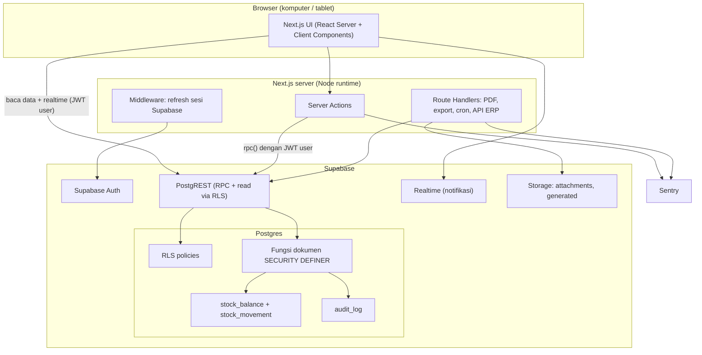
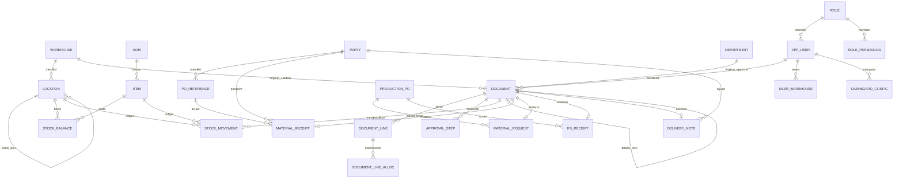
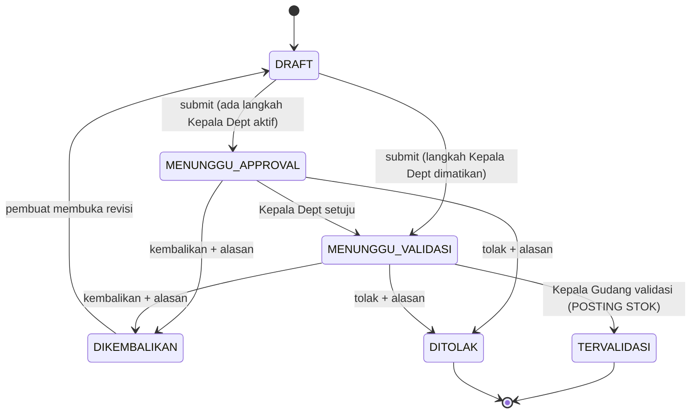
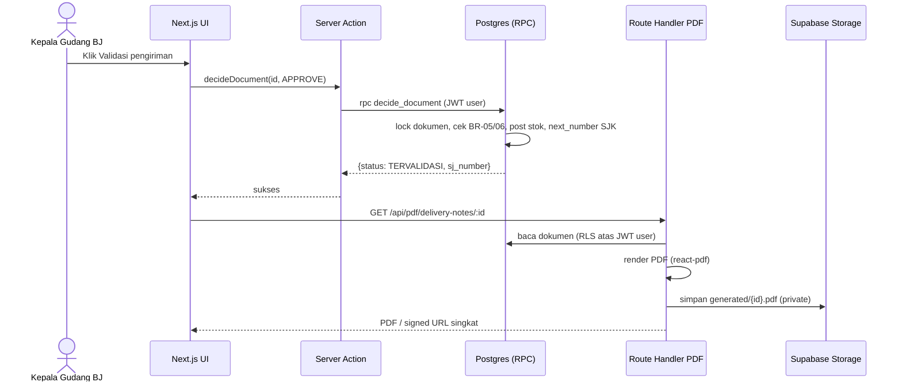

# Technical Logic — WMS Batching Plant Beton (Next.js + Supabase)

| | |
|---|---|
| **Versi** | 1.0 (draft untuk review) |
| **Tanggal** | 9 November 2026 |
| **Dokumen pasangan** | `docs/PRD - WMS Batching Plant Beton.md` (ID `FR/NFR/UC/BR` merujuk ke sana) |
| **Stack** | Next.js (App Router, TypeScript) · Supabase (Postgres, Auth, Storage, Realtime) · Sentry · GitHub Actions |
| **Pembaca** | Developer dan reviewer teknis |

**Konvensi:** bagian yang mengubah atau menambah ERD di PDF sumber ditandai **[Perubahan dari sumber]** beserta alasannya. SQL di dokumen ini adalah **spesifikasi logika**, bukan migrasi final; nama kolom boleh disesuaikan.

---

## 1. Prinsip Desain (Invarian yang Tidak Boleh Dilanggar)

| # | Invarian | Ditegakkan oleh |
|---|---|---|
| I1 | Stok tidak pernah negatif | `CHECK (qty >= 0)` + pengecekan eksplisit di fungsi posting dengan `SELECT ... FOR UPDATE` |
| I2 | Stok hanya berubah lewat satu fungsi (`private.apply_stock_deltas`) | Tidak ada policy tulis pada `stock_balance`/`stock_movement` untuk role `authenticated`; hak `EXECUTE` hanya untuk fungsi dokumen |
| I3 | Ledger (`stock_movement`) append-only | Trigger menolak `UPDATE`/`DELETE`/`TRUNCATE`, bahkan untuk `service_role` |
| I4 | Saldo = jumlah ledger | Rekonsiliasi harian; kartu stok dihitung dari ledger |
| I5 | Stok berubah **hanya** pada validasi Kepala Gudang (BR-11) | Posting dipanggil hanya dari `decide_document` pada langkah `KEPALA_GUDANG` |
| I6 | Pembuat ≠ penyetuju/validator (BR-05) | Dicek di database, bukan di UI |
| I7 | Dokumen tervalidasi tak bisa diubah (BR-07) | Trigger pada `document` dan `document_line` |
| I8 | Semua aturan di atas berlaku walau UI dilewati | Seluruh mutasi dokumen lewat fungsi RPC `SECURITY DEFINER`; UI hanya memanggil |

Keputusan arsitektur utama: **logika transaksi tinggal di Postgres (fungsi RPC), bukan di Next.js.** Alasannya: validasi stok + penulisan ledger + penomoran + perubahan status harus satu transaksi atomik (NFR-02), dan database adalah satu-satunya tempat yang bisa menjamin invarian walau ada klien lain (mis. sinkronisasi ERP kelak). Next.js bertugas sebagai UI, validasi form, orkestrasi (PDF, export, notifikasi), dan pemetaan error.

## 2. Arsitektur



**Pembagian tanggung jawab**

| Lapisan | Tanggung jawab | Bukan tanggung jawabnya |
|---|---|---|
| Next.js UI | Form, tabel, inbox, peringatan, tampilan per role | Menentukan boleh/tidaknya aksi (hanya menyembunyikan tombol) |
| Server Actions | Validasi input (zod), panggil RPC dengan JWT user, petakan error DB ke pesan, `revalidatePath` | Menulis tabel stok langsung; memakai `service_role` untuk transaksi |
| Route Handlers | Render PDF surat jalan, export Excel/PDF, endpoint cron, API baca untuk ERP | Logika bisnis |
| Postgres | Seluruh aturan bisnis, penomoran, posting stok, audit | Rendering dokumen |
| `service_role` key | **Hanya** untuk admin membuat/menonaktifkan user di Supabase Auth dan cron; tidak pernah ke browser | Transaksi bisnis harian |

**Struktur repositori**

```
src/
  app/
    (auth)/login/
    (app)/
      dashboard/
      master/{warehouses,locations,items,uoms,parties,users,departments}/
      material/{receipts,requests,transfers}/
      finished/{receipts,deliveries,transfers}/
      approvals/                 # inbox approval & validasi (UC-21)
      stock/                     # stok & kartu stok
      po/                        # pelacakan PO produksi
      reports/ audit/ admin/approval-config/
    api/
      pdf/delivery-notes/[id]/route.ts
      export/[report]/route.ts
      cron/reconcile/route.ts
      v1/{items,stock-movements}/route.ts     # P2: sumber sinkronisasi ERP
  lib/
    supabase/{server.ts,client.ts,middleware.ts}
    domain/{doc-types.ts,schemas.ts,errors.ts}   # zod + registry doc_type
    pdf/ export/
supabase/
  migrations/  seed.sql  tests/                  # pgTAP
```

**Catatan Supabase yang memengaruhi desain**
- Tabel di schema `public` terekspos lewat PostgREST. **Semua tabel wajib `ENABLE ROW LEVEL SECURITY`.** Fungsi helper berhak tinggi ditaruh di schema `private` (tidak terekspos); hanya fungsi RPC dokumen yang berada di `public`.
- Setiap fungsi `SECURITY DEFINER` memakai `SET search_path = ''` dan nama objek terkualifikasi penuh, serta `REVOKE EXECUTE ... FROM anon, public` lalu `GRANT ... TO authenticated`.
- **Otorisasi tidak boleh bersandar pada `user_metadata`** karena bisa diubah user sendiri. Otorisasi dibaca dari tabel (`app_user`, `role_permission`, `user_warehouse`) lewat `auth.uid()`. Konsekuensi baik: perubahan role/penugasan langsung berlaku tanpa menunggu token kedaluwarsa. Konsekuensi biaya: satu subquery per cek; aman untuk skala kecil-menengah, gunakan `(select auth.uid())` di policy agar di-cache planner.
- Di Next.js, otorisasi sisi server memakai `supabase.auth.getUser()` (memverifikasi ke Auth server), bukan `getSession()`.

## 3. Model Data

### 3.1 Perubahan terhadap ERD sumber **[Perubahan dari sumber]**

| # | Perubahan | Alasan |
|---|---|---|
| D1 | Tabel header tunggal `document` + tabel anak per tipe (tabel `document_line` generik) menggantikan 6 tabel header terpisah beserta `*_LINE` | Engine approval, inbox, audit, penomoran, dan pembalik semua generik; satu query inbox, tanpa SQL dinamis per tipe |
| D2 | `approval_step` memuat `cycle`, `step_role`, `scope`, `decision` yang dibuat saat submit (snapshot) | Konfigurasi yang diubah tidak mengubah dokumen berjalan (BR-13); riwayat revisi tidak hilang |
| D3 | `document_line_alloc` untuk alokasi penempatan sumber permintaan material | Sumber penempatan baru dipilih saat validasi dan satu baris bisa dipecah (FR-11, UC-11); ERD sumber hanya punya satu `location_id` per baris |
| D4 | `material_receipt.sender_party_id`, `department.head_user_id`, `deputy_user_id` pada gudang/departemen | Dibutuhkan BR-08, FR-04, BR-05/R1 |
| D5 | `stock_movement.id` bertipe `bigint identity` (bukan uuid) | Urutan deterministik untuk saldo berjalan kartu stok; indeks lebih kecil |
| D6 | `stock_balance` dan `stock_movement` menyimpan `warehouse_id` (denormalisasi) | RLS per gudang dan laporan tanpa join ke `location` |
| D7 | `production_po.status` (`PENDING`, `ACTIVE`) | PO lahir saat permintaan disubmit tetapi baru boleh dipakai penerimaan barang jadi setelah ada permintaan yang tervalidasi (lihat bagian 8) |
| D8 | `doc_counter` untuk penomoran tanpa celah | `SEQUENCE` Postgres meninggalkan celah saat rollback (NFR-09) |
| D9 | `notification`, `audit_log`, `user_warehouse`, `role_permission`, `permission`, `recon_issue` | Disebut "tabel pendukung" di sumber; dirinci di sini |

### 3.2 ERD (inti)



### 3.3 DDL spesifikasi (tabel kunci)

```sql
-- ===== Master =====
create table public.warehouse (
  id uuid primary key default gen_random_uuid(),
  code text not null unique,
  name text not null,
  category text not null check (category in ('MATERIAL','FINISHED_GOOD')),
  head_user_id   uuid references public.app_user(id),
  deputy_user_id uuid references public.app_user(id),
  is_active boolean not null default true
);

create table public.location (
  id uuid primary key default gen_random_uuid(),
  warehouse_id uuid not null references public.warehouse(id),
  parent_id uuid,
  code text not null,                       -- kode unik untuk label QR kelak
  name text not null,
  type_label text,                          -- 'zona','aisle','rak', bebas
  is_active boolean not null default true,
  unique (warehouse_id, code),
  unique (id, warehouse_id),
  -- induk wajib di gudang yang sama
  foreign key (parent_id, warehouse_id) references public.location(id, warehouse_id)
);
-- trigger lain: tolak siklus parent_id; tolak nonaktif bila sum(stock_balance.qty) > 0 (BR-09)

create table public.uom (
  id uuid primary key default gen_random_uuid(),
  code text not null unique,
  name text not null,
  uom_type text not null check (uom_type in ('MATERIAL','FINISHED_GOOD')),
  is_active boolean not null default true,
  unique (id, uom_type)
);

create table public.item (
  id uuid primary key default gen_random_uuid(),
  code text not null unique,
  name text not null,
  item_type text not null check (item_type in ('MATERIAL','FINISHED_GOOD')),
  uom_id uuid not null,
  min_stock numeric(18,4),                   -- opsional, widget stok minimum (Q13)
  is_active boolean not null default true,
  -- jenis satuan harus sama dengan jenis item, ditegakkan database (FR-24):
  foreign key (uom_id, item_type) references public.uom(id, uom_type)
);
-- trigger: uom_id tidak boleh diubah bila item sudah punya stock_movement

-- ===== Ledger dan saldo =====
create table public.stock_balance (
  item_id uuid not null references public.item(id),
  location_id uuid not null references public.location(id),
  warehouse_id uuid not null references public.warehouse(id),
  qty numeric(18,4) not null default 0 check (qty >= 0),
  updated_at timestamptz not null default now(),
  primary key (item_id, location_id)
);

create table public.stock_movement (
  id bigint generated always as identity primary key,
  warehouse_id uuid not null references public.warehouse(id),
  item_id uuid not null references public.item(id),
  location_id uuid not null references public.location(id),
  qty_in  numeric(18,4) not null default 0 check (qty_in  >= 0),
  qty_out numeric(18,4) not null default 0 check (qty_out >= 0),
  check ((qty_in > 0) <> (qty_out > 0)),     -- tepat salah satu terisi
  document_id uuid not null references public.document(id),
  doc_type text not null,
  doc_no text not null,
  line_id uuid,
  posted_at timestamptz not null default now(),
  posted_by uuid not null references public.app_user(id)
);
create index on public.stock_movement (item_id, location_id, id);
create index on public.stock_movement (warehouse_id, posted_at);
create index on public.stock_movement (document_id);

create function private.forbid_mutation() returns trigger
language plpgsql as $$ begin raise exception 'IMMUTABLE_TABLE' using errcode = 'P0001'; end $$;
create trigger movement_no_update before update or delete on public.stock_movement
  for each row execute function private.forbid_mutation();
create trigger movement_no_truncate before truncate on public.stock_movement
  for each statement execute function private.forbid_mutation();
```

```sql
-- ===== Dokumen generik =====
create table public.document (
  id uuid primary key default gen_random_uuid(),
  doc_type text not null check (doc_type in
    ('MATERIAL_RECEIPT','MATERIAL_REQUEST','STOCK_TRANSFER',
     'FG_RECEIPT','DELIVERY_NOTE','STOCK_OPNAME')),
  doc_no text,                                -- diisi saat submit pertama
  status text not null default 'DRAFT' check (status in
    ('DRAFT','MENUNGGU_APPROVAL','MENUNGGU_VALIDASI','DIKEMBALIKAN','DITOLAK','TERVALIDASI')),
  warehouse_id  uuid not null references public.warehouse(id),
  department_id uuid not null references public.department(id), -- lingkup Kepala Dept
  created_by uuid not null references public.app_user(id),
  created_at timestamptz not null default now(),
  submitted_at timestamptz,
  validated_at timestamptz,
  validated_by uuid references public.app_user(id),
  cycle int not null default 0,               -- naik tiap submit ulang
  reverses_document_id uuid references public.document(id),
  note text,
  unique (doc_type, doc_no)
);
-- satu dokumen hanya boleh punya satu pembalik yang masih hidup:
create unique index one_live_reversal on public.document (reverses_document_id)
  where reverses_document_id is not null and status <> 'DITOLAK';
create index on public.document (status, warehouse_id);
create index on public.document (created_by);

create table public.document_line (
  id uuid primary key default gen_random_uuid(),
  document_id uuid not null references public.document(id) on delete cascade,
  line_no int not null,
  item_id uuid not null references public.item(id),
  qty numeric(18,4) not null check (qty > 0),
  location_id    uuid references public.location(id),  -- tujuan (penerimaan) / sumber (pengiriman, asal pindah); NULL pada permintaan sampai validasi
  to_location_id uuid references public.location(id),  -- hanya STOCK_TRANSFER
  counted_qty numeric(18,4),                           -- hanya STOCK_OPNAME
  system_qty  numeric(18,4),                           -- hanya STOCK_OPNAME (snapshot)
  unique (document_id, line_no)
);

create table public.document_line_alloc (               -- alokasi sumber permintaan material
  id uuid primary key default gen_random_uuid(),
  line_id uuid not null references public.document_line(id) on delete cascade,
  location_id uuid not null references public.location(id),
  qty numeric(18,4) not null check (qty > 0)
);

create table public.material_receipt (
  document_id uuid primary key references public.document(id) on delete cascade,
  sj_number text not null,
  receipt_date date not null,
  sender_party_id uuid not null references public.party(id),
  po_reference_id uuid references public.po_reference(id),
  sj_reserved boolean not null default true            -- false bila ditolak (BR-08)
);
create unique index uq_sj_masuk on public.material_receipt
  (sender_party_id, lower(sj_number)) where sj_reserved;

create table public.production_po (
  id uuid primary key default gen_random_uuid(),
  po_number text not null unique,
  finished_item_id uuid not null references public.item(id),
  target_qty numeric(18,4) not null check (target_qty > 0),
  status text not null default 'PENDING' check (status in ('PENDING','ACTIVE')),
  created_by uuid not null references public.app_user(id),
  created_at timestamptz not null default now()
);
create table public.material_request (
  document_id uuid primary key references public.document(id) on delete cascade,
  production_po_id uuid not null references public.production_po(id)
);
create table public.fg_receipt (
  document_id uuid primary key references public.document(id) on delete cascade,
  production_po_id uuid not null references public.production_po(id)
);
create table public.delivery_note (
  document_id uuid primary key references public.document(id) on delete cascade,
  customer_id uuid not null references public.party(id),
  delivery_date date not null,
  customer_po_ref text,
  sj_number text unique,                               -- nomor resmi, diisi saat validasi
  pdf_path text
);
```

```sql
-- ===== Approval =====
create table public.approval_flow_config (
  doc_type text not null,
  step_order int not null,
  step_role text not null check (step_role in ('KEPALA_DEPT','KEPALA_GUDANG')),
  is_active boolean not null default true,
  primary key (doc_type, step_order),
  -- validasi Kepala Gudang tidak boleh dimatikan (BR-12):
  check (step_role <> 'KEPALA_GUDANG' or is_active)
);

create table public.approval_step (
  id uuid primary key default gen_random_uuid(),
  document_id uuid not null references public.document(id) on delete cascade,
  cycle int not null,
  step_order int not null,
  step_role text not null,
  decision text not null default 'PENDING'
    check (decision in ('PENDING','APPROVED','RETURNED','REJECTED','SKIPPED')),
  approver_id uuid references public.app_user(id),     -- terisi saat diputuskan
  reason text,
  decided_at timestamptz,
  unique (document_id, cycle, step_order)
);
create index on public.approval_step (document_id) where decision = 'PENDING';
```

### 3.4 Keputusan model: tempat stok disimpan
Stok boleh berada di **node mana pun** dalam pohon penempatan (bukan hanya leaf), karena struktur belum final dan pabrik mungkin menyimpan "di zona A" tanpa rak. Laporan "stok per zona" dihitung dengan rekursif CTE yang menjumlahkan semua turunan. Bila pabrik ingin memaksa leaf saja, cukup ditambah satu trigger tanpa mengubah skema.

### 3.5 Presisi angka
`numeric(18,4)` untuk semua kuantitas. Tidak pernah memakai `float`. Di TypeScript, kuantitas diperlakukan sebagai **string desimal** (atau `decimal.js`), bukan `number`, agar tidak ada galat pembulatan saat dikirim ke RPC.

## 4. Engine Dokumen: Status dan Approval

### 4.1 State machine



Tabel transisi (satu-satunya yang diizinkan; baris lain → `INVALID_STATE`):

| Dari | Aksi | Aktor yang sah | Ke | Efek samping |
|---|---|---|---|---|
| DRAFT | `submit_document` | pembuat | MENUNGGU_APPROVAL / MENUNGGU_VALIDASI | Penomoran, snapshot langkah, peringatan stok, notifikasi |
| MENUNGGU_APPROVAL | `decide_document(APPROVE)` | Kepala Dept scope dokumen (atau deputi), ≠ pembuat | MENUNGGU_VALIDASI | Notifikasi ke Kepala Gudang |
| MENUNGGU_VALIDASI | `decide_document(APPROVE)` | Kepala Gudang atau deputi gudang dokumen, ≠ pembuat | TERVALIDASI | **Posting stok**, penomoran SJ keluar bila ada, audit |
| MENUNGGU_* | `decide_document(RETURN)` | aktor langkah berjalan | DIKEMBALIKAN | Alasan wajib; langkah sisa → SKIPPED |
| MENUNGGU_* | `decide_document(REJECT)` | aktor langkah berjalan | DITOLAK | Alasan wajib; `sj_reserved=false` bila penerimaan; langkah sisa → SKIPPED |
| DIKEMBALIKAN | `save_draft` oleh pembuat | pembuat | DRAFT | — |
| DRAFT | `delete_draft` | pembuat | (soft delete) | Audit **[Usulan]** |

### 4.2 Fungsi RPC (publik, `SECURITY DEFINER`)

| Fungsi | Tujuan |
|---|---|
| `save_draft(p_doc_type, p_doc_id, p_payload jsonb) → uuid` | Buat/ubah draft beserta baris-barisnya secara atomik; hanya pembuat, hanya status DRAFT/DIKEMBALIKAN |
| `submit_document(p_doc_id) → jsonb` | Validasi penuh, penomoran, snapshot langkah; mengembalikan `{status, warnings[]}` |
| `decide_document(p_doc_id, p_decision, p_reason, p_allocations jsonb) → jsonb` | `APPROVE` / `RETURN` / `REJECT`; pada langkah validasi melakukan posting |
| `create_reversal(p_doc_id, p_reason) → uuid` | Membuat dokumen pembalik berstatus DRAFT (bagian 9) |
| `open_opname(...)`, `submit_count(...)` | Fase 2 |

### 4.3 Algoritma `submit_document`

```
submit_document(doc_id):
  lock row document FOR UPDATE
  assert status = 'DRAFT'  and created_by = auth.uid()            -- else INVALID_STATE / FORBIDDEN
  assert has_perm('doc.create.' || doc_type) and can_access_warehouse(warehouse_id)
  validate_lines(doc)             -- aturan per tipe, bagian 6
  if doc_no is null: doc_no := next_doc_number(series(doc_type), period)  -- bagian 7
  if doc_type = 'MATERIAL_REQUEST': upsert_production_po(...)           -- bagian 8
  cycle := cycle + 1
  steps := select * from approval_flow_config
           where doc_type = doc.doc_type and is_active order by step_order
  -- jaring pengaman: langkah KEPALA_GUDANG selalu ada dan terakhir
  insert approval_step(document_id, cycle, step_order, step_role) for each step
  for each KEPALA_DEPT step:
      assert exists eligible approver (dept.head or dept.deputy) and creator not the only eligible one
          -- else raise NO_APPROVER (Q11)
  assert eligible approver exists for KEPALA_GUDANG (warehouse.head or deputy), ≠ creator
  status := first pending step is KEPALA_DEPT ? 'MENUNGGU_APPROVAL' : 'MENUNGGU_VALIDASI'
  warnings := stock_sufficiency_warnings(doc)      -- hanya peringatan (BR-02)
  insert notification for eligible approvers of the first pending step
  audit_log(...)
  return {status, warnings}
```

Peringatan stok **tidak memblokir** dan **tidak mereservasi** stok (risiko R2). Dua dokumen yang menunggu bisa sama-sama lolos submit; yang kedua akan terblokir saat validasi.

### 4.4 Algoritma `decide_document`

```
decide_document(doc_id, decision, reason, allocations):
  lock row document FOR UPDATE                               -- serialisasi keputusan ganda
  assert status in ('MENUNGGU_APPROVAL','MENUNGGU_VALIDASI')  -- else INVALID_STATE (klik ganda aman)
  step := min(step_order) from approval_step
          where document_id = doc_id and cycle = doc.cycle and decision = 'PENDING'
  actor := auth.uid()
  assert actor <> doc.created_by                              -- BR-05  → SELF_APPROVAL
  if step.step_role = 'KEPALA_DEPT':
      assert actor in (dept.head_user_id, dept.deputy_user_id)
  else:                                                        -- KEPALA_GUDANG
      assert actor in (warehouse.head_user_id, warehouse.deputy_user_id)   -- BR-06 → NOT_WAREHOUSE_HEAD
  if decision in ('RETURN','REJECT'): assert length(trim(reason)) > 0       -- BR-10 → REASON_REQUIRED

  case decision:
    'APPROVE':
        mark step APPROVED (approver_id, decided_at)
        if step is last (KEPALA_GUDANG):
            if doc_type = 'MATERIAL_REQUEST': store allocations into document_line_alloc
            post_document(doc)                                 -- bagian 5; boleh RAISE INSUFFICIENT_STOCK
            status := 'TERVALIDASI'; validated_at, validated_by := now(), actor
            if doc_type = 'DELIVERY_NOTE': assign sj_number (bagian 7)
        else:
            status := 'MENUNGGU_VALIDASI'
    'RETURN': mark step RETURNED; others SKIPPED; status := 'DIKEMBALIKAN'
    'REJECT': mark step REJECTED; others SKIPPED; status := 'DITOLAK'
              if MATERIAL_RECEIPT: sj_reserved := false
  audit_log, notification (ke pembuat / approver berikut)
  return {status}
```

**Atomik:** seluruh fungsi satu transaksi. Jika `post_document` melempar `INSUFFICIENT_STOCK`, **keputusan APPROVE ikut dibatalkan** dan dokumen tetap `MENUNGGU_VALIDASI`; Kepala Gudang melihat pesan dan dapat mengembalikan dokumen. Ini sesuai diagram sekuens sumber ("Batalkan transaksi → validasi diblokir").

**Konfigurasi approval (UC-06).** Admin mengubah `approval_flow_config.is_active` hanya untuk langkah `KEPALA_DEPT`; constraint `check` melarang mematikan `KEPALA_GUDANG` (BR-12). Perubahan hanya memengaruhi dokumen yang disubmit sesudahnya, karena `approval_step` adalah snapshot (BR-13).

**Seed konfigurasi default** (sesuai matriks sumber):

| doc_type | step 1 | step 2 |
|---|---|---|
| MATERIAL_RECEIPT | KEPALA_DEPT | KEPALA_GUDANG |
| MATERIAL_REQUEST | KEPALA_DEPT | KEPALA_GUDANG |
| STOCK_TRANSFER | KEPALA_DEPT (nonaktif) | KEPALA_GUDANG |
| FG_RECEIPT | KEPALA_DEPT | KEPALA_GUDANG |
| DELIVERY_NOTE | KEPALA_DEPT | KEPALA_GUDANG |
| STOCK_OPNAME | KEPALA_DEPT | KEPALA_GUDANG |

**Pejabat pengganti (deputi) [Usulan, menjawab R1 dan Q11].** `deputy_user_id` pada `warehouse` dan `department`. Aktor eligible = head atau deputy. BR-05 tetap berlaku: bila pembuat adalah Kepala Dept, langkah itu hanya bisa diputuskan deputi; bila tidak ada → `NO_APPROVER` saat submit (bukan macet diam-diam di inbox). Bila pabrik menolak deputi, hapus dua kolom ini dan satu kondisi `OR`.

## 5. Layanan Stok (Posting)

### 5.1 Fungsi inti

```sql
create or replace function private.apply_stock_deltas(
  p_document_id uuid, p_doc_type text, p_doc_no text, p_actor uuid, p_deltas jsonb
) returns void
language plpgsql security definer set search_path = '' as $$
declare
  r record; v_wh uuid; v_cur numeric;
begin
  -- 1) agregasi + urutan kunci tetap (item, lokasi) → tidak ada deadlock antar transaksi
  for r in
    select (d->>'item_id')::uuid as item_id,
           (d->>'location_id')::uuid as location_id,
           sum((d->>'delta')::numeric) as delta
    from jsonb_array_elements(p_deltas) d
    group by 1, 2
    order by 1, 2
  loop
    select warehouse_id into v_wh from public.location where id = r.location_id;

    insert into public.stock_balance(item_id, location_id, warehouse_id, qty)
    values (r.item_id, r.location_id, v_wh, 0)
    on conflict (item_id, location_id) do nothing;

    select qty into v_cur from public.stock_balance
     where item_id = r.item_id and location_id = r.location_id for update;   -- kunci baris

    if v_cur + r.delta < 0 then
      raise exception 'INSUFFICIENT_STOCK' using errcode = 'P0001',
        detail = jsonb_build_object('item_id', r.item_id, 'location_id', r.location_id,
                   'available', v_cur, 'required', -r.delta)::text;
    end if;

    update public.stock_balance set qty = v_cur + r.delta, updated_at = now()
     where item_id = r.item_id and location_id = r.location_id;
  end loop;

  -- 2) satu baris ledger per baris dokumen (bukan agregat) agar kartu stok bisa ditelusuri
  insert into public.stock_movement
    (warehouse_id, item_id, location_id, qty_in, qty_out,
     document_id, doc_type, doc_no, line_id, posted_by)
  select l.warehouse_id, (d->>'item_id')::uuid, (d->>'location_id')::uuid,
         greatest((d->>'delta')::numeric, 0), greatest(-(d->>'delta')::numeric, 0),
         p_document_id, p_doc_type, p_doc_no, (d->>'line_id')::uuid, p_actor
  from jsonb_array_elements(p_deltas) d
  join public.location l on l.id = (d->>'location_id')::uuid;
end $$;
```

`SELECT ... FOR UPDATE` mengurutkan transaksi konkuren pada baris saldo yang sama; transaksi kedua membaca saldo **setelah** commit yang pertama sehingga tidak ada kondisi balapan (lost update). Constraint `CHECK (qty >= 0)` menjadi jaring terakhir.

### 5.2 `post_document`: delta per tipe dokumen

`sign = +1` untuk dokumen biasa; `−1` bila `reverses_document_id is not null` (bagian 9).

| doc_type | Sumber baris | Delta yang dikirim ke `apply_stock_deltas` | Efek tambahan saat validasi |
|---|---|---|---|
| MATERIAL_RECEIPT | `document_line` | `+qty` di `location_id`, dikali sign | — |
| MATERIAL_REQUEST | `document_line_alloc` | `−qty` di `alloc.location_id`, dikali sign | `production_po.status := 'ACTIVE'` bila masih PENDING |
| STOCK_TRANSFER | `document_line` | `−qty` di `location_id` dan `+qty` di `to_location_id` (dua delta) | Total gudang tetap (dapat diuji) |
| FG_RECEIPT | `document_line` | `+qty` di `location_id`, dikali sign | — |
| DELIVERY_NOTE | `document_line` | `−qty` di `location_id`, dikali sign | Penomoran `sj_number`; PDF dirender setelah commit (bagian 14) |
| STOCK_OPNAME | `document_line` | `counted_qty − system_qty` di `location_id` | Fase 2 (bagian 10) |

Pemeriksaan pertahanan sebelum posting, terlepas dari yang sudah dicek saat submit: kategori gudang = jenis item (BR-15); penempatan aktif dan milik `document.warehouse_id`; item aktif; pada permintaan, jumlah alokasi per baris = `qty` baris.

## 6. Aturan Validasi per Transaksi

Kolom: **S** = saat `submit_document`, **V** = saat validasi (`decide_document` pada langkah gudang). `W` = hanya peringatan.

| Aturan | Penerimaan material | Permintaan material | Pindah | Penerimaan BJ | Pengiriman |
|---|---|---|---|---|---|
| Minimal satu baris, qty > 0 | S | S | S | S | S |
| Item aktif dan jenis cocok dengan gudang (BR-15) | S, V | S, V | S, V | S, V | S, V |
| Penempatan aktif, milik gudang dokumen | S, V | V (alokasi) | S, V (asal & tujuan) | S, V | S, V |
| Nomor SJ masuk unik per pengirim (BR-08) | S (unique index) | – | – | – | – |
| Pengirim/PO referensi terisi | S | – | – | – | – |
| Qty alokasi = qty diminta | – | V | – | – | – |
| Stok cukup di penempatan sumber | – | **S: W**, **V: blokir** | S: W, V: blokir | – | **S: W**, **V: blokir** |
| Asal ≠ tujuan | – | – | S | – | – |
| PO produksi: unik/sesuai (BR-03) | – | S | – | – | – |
| PO produksi sudah ada dan `ACTIVE` | – | – | – | S, V | – |
| Item = produk target PO | – | – | – | S | – |
| Total terima ≤ target | – | – | – | **W** (BR-04) | – |
| Customer terisi | – | – | – | – | S |

Setiap aturan "blokir" mengembalikan kode error terstruktur (bagian 15).

## 7. Penomoran Dokumen

| Nomor | Contoh format (Q8) | Diberikan saat | Boleh ada celah? |
|---|---|---|---|
| Nomor internal dokumen (`document.doc_no`): `RCV`, `REQ`, `TRF`, `FGR`, `DLV`, `OPN` | `REQ/2026/11/0007` | Submit pertama (draft yang tak pernah dikirim tidak memakai nomor) | Ya |
| Nomor **surat jalan keluar resmi** (`delivery_note.sj_number`) | `SJK/2026/11/0001` | **Validasi** (dalam transaksi yang sama dengan posting) | **Tidak** (NFR-09) |

Implementasi tanpa celah memakai tabel counter, **bukan** `SEQUENCE`:

```sql
create table public.doc_counter (
  series text not null, period text not null, last_value int not null default 0,
  primary key (series, period)
);

create function private.next_number(p_series text, p_period text) returns int
language plpgsql security definer set search_path = '' as $$
declare v int;
begin
  insert into public.doc_counter(series, period, last_value) values (p_series, p_period, 1)
  on conflict (series, period)
  do update set last_value = public.doc_counter.last_value + 1
  returning last_value into v;
  return v;     -- kunci baris dilepas saat commit; rollback membatalkan kenaikan → tanpa celah
end $$;
```

Konsekuensi yang disengaja: dua validasi pengiriman yang bersamaan akan antre pada baris counter. Pada skala pabrik ini (puluhan pengiriman per hari) tidak berdampak. Reset periode bulanan adalah default; ubah `period` menjadi tahun saja bila pabrik menginginkan nomor menerus setahun.

## 8. PO Produksi

**Aturan sumber:** PO lahir hanya dari permintaan material (BR-03); penerimaan barang jadi hanya memilih (FR-13).

```
upsert_production_po(po_number, finished_item_id, target_qty)   -- dipanggil dari submit_document (MATERIAL_REQUEST)
  select * from production_po where po_number = ... for update
  if not found:
      insert (status = 'PENDING', created_by = auth.uid())
  else:
      assert existing.finished_item_id = finished_item_id and existing.target_qty = target_qty
             -- else PO_MISMATCH: input ulang nomor PO yang sama tidak boleh mengubah produk/target
  return id
```

Konsekuensi desain:
- Permintaan kedua dengan nomor PO yang sama **memakai kembali** PO tersebut (permintaan tambahan material). Ini menjawab Q12 dengan default "ya".
- Bila permintaan pertama ditolak, PO tetap `PENDING` (tanpa dampak stok) dan nomor yang sama bisa dipakai permintaan baru. Tanpa status ini, PO akan "terkunci" oleh permintaan yang ditolak.
- Picker penerimaan barang jadi hanya menampilkan `status = 'ACTIVE'`, yakni minimal satu permintaan sudah tervalidasi, sehingga barang jadi tidak bisa diterima untuk PO yang materialnya belum pernah keluar.
- Pengubahan target setelah dibuat sengaja tidak tersedia di fase 1; bila dibutuhkan, itu perubahan master, bukan lewat permintaan material.

**Pelacakan PO (FR-14, UC-17)** dihitung dari dokumen tervalidasi, dengan memperhitungkan pembalik:

```sql
create view public.v_production_po_progress with (security_invoker = true) as
select po.id, po.po_number, po.target_qty, po.status,
  coalesce(sum(case when d.doc_type = 'FG_RECEIPT'
                    then dl.qty * case when d.reverses_document_id is null then 1 else -1 end end), 0)
      as received_qty,
  po.target_qty - coalesce(sum(case when d.doc_type = 'FG_RECEIPT'
                    then dl.qty * case when d.reverses_document_id is null then 1 else -1 end end), 0)
      as remaining_qty
from public.production_po po
left join public.fg_receipt fr on fr.production_po_id = po.id
left join public.document d on d.id = fr.document_id and d.status = 'TERVALIDASI'
left join public.document_line dl on dl.document_id = d.id
group by po.id;
```

`security_invoker = true` (Postgres 15+) membuat view mengikuti RLS pemanggil. View yang memakai default `security definer` akan membocorkan data lintas gudang. Tampilan "material diambil per item" memakai pola yang sama atas `document_line_alloc`.

## 9. Transaksi Pembalik (BR-07, UC-24)

Dokumen tervalidasi tidak pernah diedit. Koreksi = dokumen baru yang membalik efek stok dan melewati approval yang sama.

```
create_reversal(original_id, reason):
  assert original.status = 'TERVALIDASI' and original.reverses_document_id is null   -- tak ada pembalik-atas-pembalik
  assert can_access_warehouse(original.warehouse_id) and has_perm('doc.create.reversal')
  insert document (doc_type = original.doc_type, reverses_document_id = original.id,
                   warehouse_id, department_id := original.department_id, note := reason, status 'DRAFT')
  copy document_line, dan document_line_alloc (untuk MATERIAL_REQUEST), dari dokumen asal
  -- unique index one_live_reversal menolak pembalik kedua → ALREADY_REVERSED
```

- Posting memakai `sign = −1`. Pembalik penerimaan mengurangi stok; pembalik permintaan **mengembalikan** material ke penempatan alokasi asal; pembalik pengiriman menambah stok.
- **Pembalik bisa terblokir `INSUFFICIENT_STOCK`**, misalnya penerimaan yang materialnya sudah dipakai produksi. Itu benar: koreksi untuk kasus ini adalah stock opname/penyesuaian, bukan pembalik. Pesan error harus menjelaskan ini.
- Nomor `sj_number` pengiriman **tidak dilepas** saat dibalik (nomor resmi yang sudah beredar). PDF dicetak ulang dengan tanda **DIBATALKAN** bila dokumen punya pembalik tervalidasi.
- Ledger tetap memuat dua dokumen (asal dan pembalik); kartu stok menampilkan keduanya, sehingga audit utuh.

## 10. Stock Opname (Fase 2, data model disiapkan sejak fase 1)

| Langkah | Logika |
|---|---|
| Buka sesi | `document(doc_type='STOCK_OPNAME')` per gudang; lingkup = daftar penempatan; sistem menyalin `system_qty` per (item, penempatan) ke `document_line` sebagai snapshot |
| Hitung fisik | Staff mengisi `counted_qty`; selisih = `counted_qty − system_qty` |
| Approval | Alur sama (Kepala Dept pembuat, Kepala Gudang); Kepala Gudang menyetujui hasil opname |
| Validasi | `post_document` menulis ledger `doc_type='STOCK_OPNAME'` sebesar selisih (masuk bila positif, keluar bila negatif) |
| Penguncian (Q9) | **Default yang disarankan:** kunci lunak, yakni selama sesi `OPEN` penempatan lingkupnya tidak dapat menjadi tujuan/asal dokumen yang akan divalidasi (`LOCATION_UNDER_COUNT`). Dengan kunci ini `saldo = system_qty` pada saat validasi sehingga selisih benar |
| Tanpa kunci | Jika pabrik menolak penguncian, hitung ulang selisih terhadap saldo saat validasi dan tampilkan peringatan bila saldo berubah sejak snapshot, karena selisih mentah bisa palsu |

Tabel tambahan: `opname_lock(document_id, location_id)` dengan unique `(location_id)` selama sesi berlangsung.

## 11. Autentikasi dan Otorisasi

### 11.1 Autentikasi (Supabase Auth)
- Skenario: **berdiri sendiri**. Tidak ada portal/ERP induk; PDF menyebut JWT internal + RBAC, dan Supabase Auth menyediakannya.
- Login "username + password" (UC-01): Supabase Auth memakai email. Gunakan email nyata, atau alamat sintetis `<username>@wms.local` yang dipetakan di server (user tidak melihat email). Jangan menyediakan RPC publik pencari username→email karena membuka enumerasi user.
- Admin membuat user lewat Server Action yang memanggil Admin API dengan `service_role`, **setelah** `has_perm('user.manage')` lolos; profil dibuat di `app_user` (`id = auth.users.id`) dalam satu langkah.
- Menonaktifkan user = `app_user.is_active = false` **dan** ban di Auth; kedua sisi diperlukan (token yang sudah terbit tetap hidup sampai kedaluwarsa, tetapi `has_perm()` langsung mengembalikan false).
- MFA TOTP (opsional untuk Kepala Gudang dan Admin) didukung Supabase Auth; wajibkan aal2 melalui policy bila pabrik meminta.
- Rate limiting login dan proteksi password bocor memakai pengaturan Supabase Auth; kebijakan password minimal 10 karakter.

### 11.2 Model hak akses

```
app_user ── role_id ──▶ role ──▶ role_permission ──▶ permission(code)
app_user ──▶ user_warehouse(user_id, warehouse_id)   # staff dan kepala: gudang yang boleh diakses
warehouse.head_user_id / deputy_user_id, department.head_user_id / deputy_user_id   # otoritas keputusan
```

Dua lapis yang berbeda sengaja dipisah: **permission** menjawab "boleh jenis aksi ini?", **keanggotaan gudang/departemen** menjawab "pada data yang mana?", dan **head/deputy** menjawab "siapa yang memutuskan dokumen ini".

| Permission (contoh) | A1 | A2 | A3 | A4 | A5 | A6 | A7 |
|---|:-:|:-:|:-:|:-:|:-:|:-:|:-:|
| `master.manage` | | | | | | ✔ | |
| `location.manage` (gudang miliknya) | | | | | ✔ | ✔ | |
| `doc.create.material_receipt` | ✔ | | | | | | |
| `doc.create.material_request` | | | ✔ | | | | |
| `doc.create.fg_receipt` / `delivery_note` | | ✔ | | | | | |
| `doc.create.stock_transfer` | ✔ | ✔ | | | | | |
| `doc.create.reversal` | ✔ | ✔ | | | | | |
| `doc.decide` (dipakai untuk approval dan validasi; otoritas sebenarnya ditentukan head/deputy) | | | | ✔ | ✔ | | |
| `approval_config.manage` | | | | | | ✔ | |
| `report.read.<nama>` | sesuai katalog PRD bagian 10 | | | | | | |
| `audit.read` | | | | | | ✔ | ✔ |
| `dashboard.manage_all` | | | | | | ✔ | |

### 11.3 Contoh RLS

```sql
alter table public.document enable row level security;
alter table public.stock_balance enable row level security;
alter table public.stock_movement enable row level security;

-- fungsi bantu (schema private, tidak terekspos)
create function private.has_perm(p text) returns boolean language sql stable
security definer set search_path = '' as $$
  select exists (
    select 1 from public.app_user u
    join public.role_permission rp on rp.role_id = u.role_id
    join public.permission pm on pm.id = rp.permission_id
    where u.id = (select auth.uid()) and u.is_active and pm.code = p);
$$;

create function private.can_access_warehouse(w uuid) returns boolean language sql stable
security definer set search_path = '' as $$
  select private.has_perm('report.read.all')
      or exists (select 1 from public.user_warehouse uw
                 where uw.user_id = (select auth.uid()) and uw.warehouse_id = w)
      or exists (select 1 from public.warehouse wh
                 where wh.id = w and (select auth.uid()) in (wh.head_user_id, wh.deputy_user_id));
$$;

-- baca saja; TIDAK ADA policy insert/update/delete untuk authenticated
create policy stock_balance_read on public.stock_balance for select to authenticated
  using (private.can_access_warehouse(warehouse_id));
create policy stock_movement_read on public.stock_movement for select to authenticated
  using (private.can_access_warehouse(warehouse_id));

create policy document_read on public.document for select to authenticated
  using ( created_by = (select auth.uid())
       or private.can_access_warehouse(warehouse_id)
       or exists (select 1 from public.department d
                  where d.id = department_id
                    and (select auth.uid()) in (d.head_user_id, d.deputy_user_id)) );

revoke insert, update, delete on public.document, public.document_line,
       public.stock_balance, public.stock_movement from authenticated, anon;
```

Staff Departemen (A3) tidak punya baris `user_warehouse`, sehingga hanya melihat dokumen buatannya sendiri dan tidak melihat stok gudang. Bila produksi perlu melihat ketersediaan material saat membuat permintaan, sediakan RPC `get_material_availability(item_id)` yang hanya mengembalikan **total** per item, bukan lokasi.

**Master data** (gudang, item, satuan, pihak, penempatan) boleh ditulis langsung lewat PostgREST dengan policy `has_perm('master.manage')`, ditambah trigger audit. Hanya jalur **dokumen dan stok** yang wajib RPC.

## 12. Laporan, Kartu Stok, dan Dashboard

### 12.1 Kartu stok (FR-18)

```sql
-- p_from, p_to; filter item dan penempatan opsional
with opening as (
  select coalesce(sum(qty_in - qty_out), 0) as qty
  from public.stock_movement
  where item_id = $1 and location_id = $2 and posted_at < $3),
rows as (
  select id, posted_at, doc_type, doc_no, document_id, qty_in, qty_out
  from public.stock_movement
  where item_id = $1 and location_id = $2 and posted_at >= $3 and posted_at < $4)
select r.*, (select qty from opening)
         + sum(r.qty_in - r.qty_out) over (order by r.id) as saldo
from rows r order by r.id;
```

Saldo awal dan saldo berjalan dihitung dari ledger, sedangkan `stock_balance` dipakai untuk tampilan "stok saat ini". Keduanya wajib sama (invarian I4). Untuk kartu stok tingkat gudang atau zona, `location_id = $2` diganti `location_id in (descendants)` memakai CTE rekursif.

### 12.2 Pembentukan laporan
- Seluruh laporan berupa **view `security_invoker`** atau fungsi `SECURITY INVOKER`, sehingga RLS otomatis membatasi baris sesuai gudang/role. Dengan begitu Excel/PDF hasil export tidak pernah lebih luas dari yang bisa dilihat user.
- Permission `report.read.<nama>` dicek di Route Handler (`/api/export/[report]`) **dan** di RLS; yang pertama untuk pesan ramah, yang kedua sebagai penjaga akhir.
- Export Excel: `exceljs` di Route Handler (Node runtime), streaming bila baris banyak. Export PDF: `@react-pdf/renderer`. Bila di-hosting dengan batas waktu fungsi ketat, batasi rentang tanggal atau jadikan tugas asinkron (tulis file ke Storage lalu kirim notifikasi) **[Usulan]**.

### 12.3 Dashboard per user (FR-20)
- `dashboard_config(user_id pk, widgets jsonb)`; policy: pemilik boleh baca/tulis; user dengan `dashboard.manage_all` boleh menulis milik user lain (Admin mengatur dashboard user, sesuai sumber).
- Katalog widget didefinisikan **di kode** (`lib/domain/widgets.ts`) dengan skema zod untuk `filters`; JSON hanya menyimpan `{type, filters, order}`. Tipe widget yang tidak dikenal diabaikan agar aman terhadap data lama.
- Tiap widget membaca dari view/RPC yang sudah ber-RLS, jadi widget tidak pernah menampilkan data di luar hak akses walau konfigurasinya diubah manual.
- Role tanpa konfigurasi menampilkan **dashboard default per role** (di-seed). Ini juga yang menutupi go-live bila widget picker ditunda (PRD bagian 5).

## 13. Notifikasi In-App (FR-23)

```
notification(id, user_id, document_id, kind, message, created_at, read_at)
kind ∈ {APPROVAL_NEEDED, VALIDATION_NEEDED, RETURNED, REJECTED, VALIDATED}
```
- Ditulis oleh fungsi RPC dalam transaksi yang sama dengan perubahan status; tidak ada notifikasi "hantu" bila transaksi gagal.
- Klien berlangganan **Supabase Realtime** (`postgres_changes` pada `notification` dengan filter `user_id`); Realtime menghormati RLS, jadi user hanya menerima miliknya.
- Inbox approval (UC-21) **bukan** diturunkan dari notifikasi, melainkan query langsung ke `approval_step` yang `PENDING` dan eligible untuk user. Notifikasi bisa hilang atau terbaca, inbox tetap benar.
- Email/WhatsApp (fase berikutnya) cukup menjadi konsumen tabel `notification`.

## 14. Surat Jalan PDF, Storage, dan Lampiran



- PDF dirender **setelah** transaksi validasi commit dan **dari data tervalidasi yang tidak berubah**, jadi aman dicache di Storage dengan kunci `document_id`. Bila dokumen dibalik (bagian 9), hapus cache dan render ulang dengan penanda DIBATALKAN.
- Kegagalan render PDF **tidak boleh membatalkan validasi** (stok sudah benar dan nomor sudah terbit). Tombol "cetak ulang" tersedia; error dikirim ke Sentry.
- Bucket `attachments` (foto surat jalan masuk) dan `generated` (PDF) bersifat **private**; policy `storage.objects` mengikuti akses dokumen induk; akses lewat signed URL berumur pendek. Batasi tipe file (jpeg, png, pdf) dan ukuran (mis. 5 MB) di server.

## 15. Penanganan Error, Konkurensi, dan Idempotensi

### 15.1 Kode error domain
Fungsi memakai `RAISE EXCEPTION '<KODE>' USING ERRCODE = 'P0001', DETAIL = <json>`. Server Action memetakan `error.message` ke pesan Indonesia (`lib/domain/errors.ts`); kode tak dikenal dilaporkan ke Sentry dan ditampilkan sebagai kesalahan umum.

| Kode | Makna | Contoh pemicu |
|---|---|---|
| `INSUFFICIENT_STOCK` | Stok penempatan tidak cukup (detail: item, lokasi, tersedia, dibutuhkan) | Validasi permintaan/pengiriman/pindah/pembalik |
| `DUPLICATE_SJ` | Surat jalan masuk sudah ada untuk pengirim ini | Submit penerimaan |
| `SELF_APPROVAL` | Pembuat mencoba memutuskan dokumennya | BR-05 |
| `NOT_AUTHORIZED_FOR_STEP` / `NOT_WAREHOUSE_HEAD` | Bukan approver/Kepala Gudang gudang ini | BR-06 |
| `INVALID_STATE` | Transisi tidak sah atau sudah diputuskan | Klik ganda, tab kedaluwarsa |
| `REASON_REQUIRED` | Alasan kosong | BR-10 |
| `NO_APPROVER` | Tidak ada approver eligible | Pembuat = Kepala Dept tanpa deputi |
| `LOCATION_HAS_STOCK` | Penempatan masih berisi stok | Nonaktifkan lokasi (BR-09) |
| `ITEM_WAREHOUSE_MISMATCH` | Jenis item ≠ kategori gudang | BR-15 |
| `PO_MISMATCH` / `PO_NOT_ACTIVE` | Produk/target PO berbeda; PO belum ACTIVE | Bagian 8 |
| `ALREADY_REVERSED` | Dokumen sudah punya pembalik | Bagian 9 |
| `LOCATION_UNDER_COUNT` | Lokasi sedang diopname | Fase 2 |
| `IMMUTABLE_TABLE` / `DOCUMENT_LOCKED` | Mencoba mengubah ledger/dokumen tervalidasi | BR-07 |

### 15.2 Konkurensi dan idempotensi
- Kunci baris `document` saat memutuskan membuat dua klik "Validasi" bersamaan berakhir satu sukses dan satu `INVALID_STATE` (tidak ada posting ganda).
- Urutan kunci `stock_balance` selalu `(item_id, location_id)` menaik, sehingga dua transaksi berlawanan arah (mis. pindah A→B dan B→A) tidak deadlock.
- Aksi UI yang memanggil RPC harus aman diulang: karena status dicek di dalam fungsi, retry jaringan tidak menggandakan efek. Tidak diperlukan idempotency key terpisah di fase 1.
- Level isolasi default `READ COMMITTED` cukup karena semua baca-lalu-tulis kritis memakai `FOR UPDATE`.

## 16. Audit Trail dan Monitoring: Dibedakan dengan Tegas

Lima hal ini sering terlihat mirip dan **tidak boleh saling menggantikan**:

| Mekanisme | Menjawab | Penyimpanan | Siapa yang membaca |
|---|---|---|---|
| **Ledger** `stock_movement` | Apa yang terjadi pada stok, atas dokumen apa | Postgres, append-only | Gudang, auditor |
| **Riwayat approval** `approval_step` | Siapa memutuskan apa atas dokumen, kapan, dengan alasan apa | Postgres | Approver, auditor |
| **Audit log** `audit_log` (FR-22) | Siapa mengubah master data/konfigurasi/status dokumen: nilai sebelum dan sesudah | Postgres, append-only | Admin, Manajemen |
| **Error monitoring** Sentry | Kejadian teknis: exception, regresi | Sentry | Developer |
| **Log integrasi** (P2, ERP) | Bukti payload yang dikirim/diterima saat sengketa | Tabel terpisah | Developer, pemilik integrasi |

```sql
create table public.audit_log (
  id bigint generated always as identity primary key,
  at timestamptz not null default now(),
  actor_id uuid,                              -- auth.uid(); NULL bila dari proses sistem
  action text not null,                       -- INSERT/UPDATE/DELETE/STATUS_CHANGE/...
  entity_type text not null,
  entity_id text not null,
  before jsonb, after jsonb
);
-- trigger generik pada tabel master & konfigurasi: menulis to_jsonb(OLD)/to_jsonb(NEW)
-- RPC dokumen menulis STATUS_CHANGE secara eksplisit
-- trigger forbid_mutation seperti ledger; policy select hanya untuk audit.read
```

**Rekonsiliasi harian (invarian I4):** endpoint `/api/cron/reconcile` (dipanggil Vercel Cron atau `pg_cron` + `pg_net`, dilindungi secret) menjalankan:

```sql
select b.item_id, b.location_id, b.qty as balance, coalesce(m.net, 0) as ledger
from public.stock_balance b
left join (select item_id, location_id, sum(qty_in - qty_out) as net
           from public.stock_movement group by 1, 2) m using (item_id, location_id)
where b.qty <> coalesce(m.net, 0);
```
Hasil tak kosong → tulis ke `recon_issue` dan kirim ke Sentry sebagai peringatan. Hasil harus **selalu kosong**; satu baris berarti ada jalur penulisan yang menyalahi invarian I2.

## 17. Antarmuka (Server Actions dan API)

Server Actions dipakai untuk semua mutasi dari UI; Route Handler hanya untuk berkas biner dan konsumen eksternal.

| Kelompok | Titik masuk | Memanggil | Catatan |
|---|---|---|---|
| Draft dokumen | Server Action `saveDraft` | RPC `save_draft` | Validasi zod; kuantitas sebagai string desimal |
| Submit | `submitDocument` | RPC `submit_document` | Menampilkan `warnings` ke pembuat |
| Keputusan | `decideDocument` | RPC `decide_document` | Kepala Gudang mengirim `allocations` untuk permintaan |
| Pembalik | `createReversal` | RPC `create_reversal` | — |
| Master data | Server Action CRUD | Tabel via PostgREST + RLS | Trigger audit |
| Inbox, stok, kartu stok, PO | Server Component | View/RPC `security_invoker` | Tanpa `service_role` |
| Surat jalan PDF | `GET /api/pdf/delivery-notes/[id]` | Bagian 14 | Cek akses lewat RLS |
| Export | `GET /api/export/[report]?format=xlsx` atau `pdf` | View laporan | Param tervalidasi (zod) |
| Cron | `GET /api/cron/reconcile` | Bagian 16 | Header secret |
| **API ERP (P2)** | `GET /api/v1/items`, `GET /api/v1/stock-movements?since=` | View baca | API key ter-hash di tabel `api_client`; hanya baca; `since` memakai `stock_movement.id` sebagai kursor |

Contoh kerangka Server Action:

```ts
'use server'
import { revalidatePath } from 'next/cache'
import { createClient } from '@/lib/supabase/server'
import { DecideSchema } from '@/lib/domain/schemas'
import { mapDbError } from '@/lib/domain/errors'

export async function decideDocument(raw: unknown) {
  const input = DecideSchema.parse(raw)               // zod: id uuid, decision enum, reason, allocations
  const supabase = await createClient()               // @supabase/ssr, cookie JWT user
  const { data: { user } } = await supabase.auth.getUser()
  if (!user) return { ok: false as const, code: 'UNAUTHENTICATED' }

  const { data, error } = await supabase.rpc('decide_document', {
    p_doc_id: input.id, p_decision: input.decision,
    p_reason: input.reason ?? null, p_allocations: input.allocations ?? null,
  })
  if (error) return { ok: false as const, ...mapDbError(error) }  // juga lapor ke Sentry bila kode tak dikenal
  revalidatePath('/approvals')
  return { ok: true as const, data }
}
```

## 18. Keamanan (Pemetaan OWASP Top 10)

| Risiko | Pengendalian |
|---|---|
| A01 Broken Access Control | RLS pada semua tabel; mutasi hanya via RPC yang mengecek `auth.uid()`; cek head/deputy dan BR-05/06 di database; UI hanya menyembunyikan tombol |
| A02 Cryptographic Failures | Password di-hash oleh Supabase Auth; HTTPS wajib; bucket private + signed URL |
| A03 Injection | Hanya RPC/parameter terikat; tidak ada SQL dinamis dari input user; zod di tepi |
| A04 Insecure Design | Invarian di database (bagian 1); pemisahan tugas dan ledger append-only |
| A05 Misconfiguration | `search_path=''` pada fungsi definer; `REVOKE` dari `anon`; `service_role` hanya di server; RLS-off dilarang lewat pemeriksaan migrasi di CI |
| A07 Authentication Failures | Rate limit login, kebijakan password, MFA opsional untuk Kepala Gudang/Admin |
| A08 Integrity Failures | Trigger imutabilitas; migrasi hanya lewat Git + CI |
| A09 Logging Failures | Audit log + approval + Sentry (dipisah, bagian 16) |
| CSRF | Server Actions Next.js memeriksa asal; cookie `SameSite` default `@supabase/ssr` |
| Kebocoran lewat view | Semua view `security_invoker = true` |

## 19. Strategi Pengujian

| Lapisan | Alat | Cakupan wajib |
|---|---|---|
| Aturan database | **pgTAP** (`supabase test db`) | Semua baris bagian 20 |
| Skema form dan pemetaan error | Vitest | zod, `mapDbError`, penanganan desimal |
| End-to-end | Playwright | Tiga alur UAT: penerimaan material → permintaan → pengiriman, dengan tiga akun berbeda |
| Konkurensi | Skrip pgTAP/Node dua koneksi | Validasi bersamaan tidak menembus stok nol |
| Keamanan akses | pgTAP dengan `set role authenticated` + `request.jwt.claims` | User gudang A tidak bisa baca/validasi gudang B |

## 20. Skenario Uji Invarian (minimal)

1. Validasi permintaan dengan stok cukup → saldo berkurang tepat sebesar alokasi; ledger punya baris keluar; dokumen TERVALIDASI.
2. Validasi dengan stok kurang → error `INSUFFICIENT_STOCK`; saldo, ledger, dan status dokumen **tidak berubah** (rollback utuh).
3. Dua validasi serentak atas stok yang hanya cukup untuk satu → tepat satu sukses.
4. Dua klik validasi pada dokumen yang sama → satu sukses, satu `INVALID_STATE`; ledger tidak ganda.
5. Pembuat memutuskan dokumennya sendiri → `SELF_APPROVAL`, di semua langkah.
6. Kepala Gudang A memvalidasi dokumen gudang B → `NOT_WAREHOUSE_HEAD`.
7. `UPDATE`/`DELETE` pada `stock_movement` (termasuk memakai `service_role`) → `IMMUTABLE_TABLE`.
8. `UPDATE` pada dokumen/baris yang sudah TERVALIDASI → ditolak.
9. Admin mencoba `is_active=false` pada langkah `KEPALA_GUDANG` → constraint menolak.
10. Mengubah konfigurasi approval saat dokumen berjalan → dokumen berjalan tetap memakai snapshot.
11. Pindah penempatan: jumlah total per item per gudang sebelum dan sesudah **identik**.
12. Item material pada gudang barang jadi → `ITEM_WAREHOUSE_MISMATCH`; item material dengan satuan barang jadi → ditolak FK komposit.
13. Surat jalan masuk duplikat (pengirim sama) → `DUPLICATE_SJ`; setelah dokumen **ditolak**, nomor yang sama bisa dipakai lagi.
14. Nonaktifkan penempatan berisi stok → `LOCATION_HAS_STOCK`.
15. 100 validasi pengiriman paralel → nomor `SJK` berurutan tanpa celah dan tanpa duplikat; satu rollback tidak meninggalkan celah.
16. Penerimaan barang jadi melebihi target PO → lolos dengan peringatan; PO `PENDING` tidak muncul di picker.
17. Pembalik penerimaan saat materialnya sudah terpakai → `INSUFFICIENT_STOCK`; pembalik kedua atas dokumen yang sama → `ALREADY_REVERSED`.
18. Rekonsiliasi setelah semua skenario di atas → nol selisih.
19. Staff Departemen tidak dapat `select` pada `stock_balance`.
20. Kartu stok: saldo akhir = saldo `stock_balance` untuk (item, lokasi) yang sama.

## 21. Pemetaan Kebutuhan → Komponen

| Kebutuhan | Komponen utama |
|---|---|
| FR-01–05, FR-24 | Tabel master + RLS `master.manage` + trigger audit |
| FR-06–08, FR-09–12, FR-13, FR-15, FR-16–17 | `document` + RPC dokumen + `post_document` |
| FR-14 | `v_production_po_progress` |
| FR-18 | Query kartu stok (12.1) |
| FR-19 | Bagian 10 |
| FR-20 | `dashboard_config` + katalog widget |
| FR-21 | View `security_invoker` + Route Handler export |
| FR-22, NFR-04 | `audit_log` + `approval_step` + ledger |
| FR-23 | `notification` + Realtime |
| NFR-02 | Invarian I1–I4, I7 |
| NFR-03 | RLS, RPC definer, OWASP (bagian 18) |
| NFR-06 | Backup harian Supabase + **uji restore terjadwal** (jangan hanya mengandalkan backup) |
| NFR-08 | Pohon `location` + `warehouse` sebagai data |
| NFR-09 | `doc_counter` + PDF (bagian 7, 14) |

## 22. Urutan Pengerjaan Teknis

| Tahap | Isi | Keluaran yang dapat diuji |
|---|---|---|
| **T0 Fondasi** | Proyek Next.js + Supabase CLI, CI (lint, tipe, `supabase db lint`, pgTAP, cek "semua tabel ber-RLS"), Sentry, Supabase Auth + `app_user` + permission, master data, audit trigger, `doc_counter` | Admin membuat gudang/penempatan/item/user; audit log terisi |
| **T1 Mesin stok** | `stock_balance`/`stock_movement` + trigger imutabilitas + `apply_stock_deltas` + `document` + `approval_*` + `save_draft`/`submit`/`decide` | Skenario uji 1–10 lulus di pgTAP sebelum ada UI transaksi |
| **T2 Gudang material** | Penerimaan, permintaan + PO produksi + alokasi, pindah; UI tablet; stok + kartu stok | Alur penerimaan → permintaan end-to-end |
| **T3 Barang jadi** | Penerimaan (PO picker), pengiriman, SJK + PDF, pelacakan PO | Alur lengkap sampai surat jalan |
| **T4 Approval UX dan pelaporan** | Inbox, notifikasi, konfigurasi alur, pembalik, laporan + export, dashboard | UAT tiga akun |
| **T5 Opname (fase 2)** | Bagian 10 | Skenario opname |

Tahap T1 sengaja **mendahului UI**: seluruh invarian bisnis dibuktikan di database lebih dulu, sehingga UI di T2–T4 hanya menjadi lapisan tampilan yang tidak bisa merusak data.

## 23. Keputusan yang Menunggu Konfirmasi

| # | Keputusan | Default dokumen ini | Terkait |
|---|---|---|---|
| K1 | Deputi untuk Kepala Dept/Gudang | Ada (`deputy_user_id`) | Q11, R1 |
| K2 | Langkah validasi Kepala Gudang tidak bisa dimatikan | Ya (BR-12) | PRD bagian 14 butir 2 |
| K3 | Approver boleh sekaligus menjadi validator | Boleh | PRD bagian 14 butir 5 |
| K4 | Stok boleh di node non-leaf | Boleh | Bagian 3.4 |
| K5 | Reset penomoran bulanan | Bulanan, `SJK/YYYY/MM/NNNN` | Q8 |
| K6 | Opname mengunci penempatan yang dihitung | Ya (kunci lunak) | Q9 |
| K7 | Hosting | Supabase Cloud + Vercel (atau Node server); bila pabrik mewajibkan on-premise: Supabase self-host (Docker) atau PostgreSQL + NestJS dengan logika RPC dipindah ke service layer | Sumber hal. 26 |

**Catatan bila beralih ke on-premise tanpa Supabase:** invarian di bagian 1 dan skema di bagian 3 tetap berlaku utuh karena berada di Postgres; yang diganti hanya Auth, Storage, Realtime, dan lapisan RPC → service NestJS.
